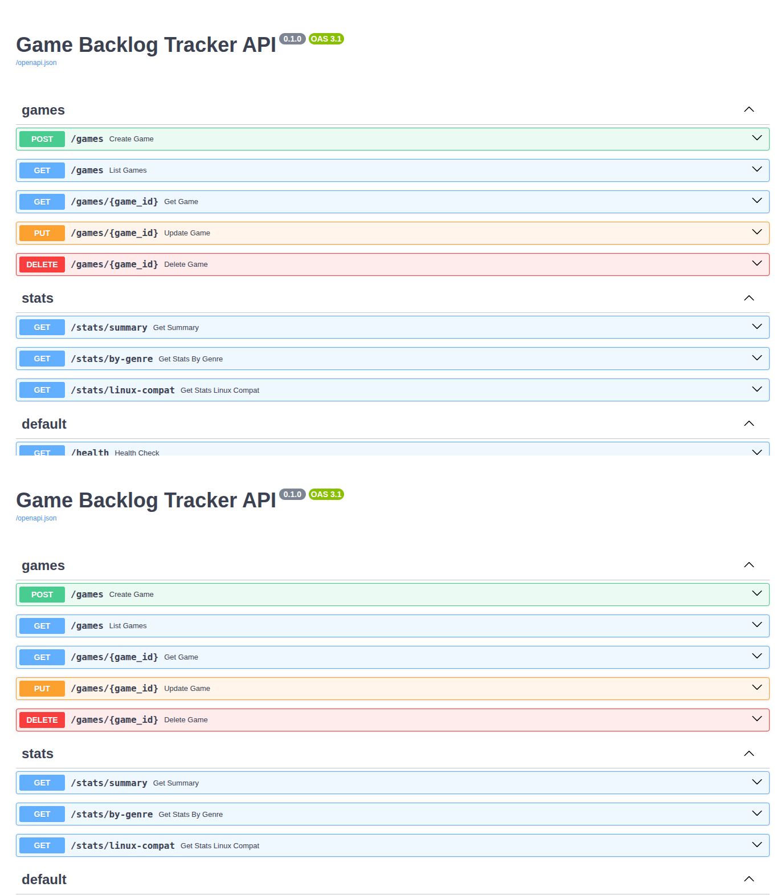

# Game Backlog Tracker API

API REST para gestionar una biblioteca personal de videojuegos: qué tienes, qué estás jugando, qué terminaste, cuántas horas le dedicaste y si corre en Linux.

Proyecto de portafolio construido con **FastAPI**, **SQLAlchemy**, **SQLite**, **Pandas** y **pytest**.



## Tecnologías

- **Python 3.11+** (probado con 3.12)
- **FastAPI** + **Pydantic** para las rutas y la validación
- **Uvicorn** como servidor
- **SQLAlchemy** como ORM sobre **SQLite**
- **Pandas** para las estadísticas
- **pytest** + `TestClient` para los tests

## Estructura del proyecto

```text
game-backlog-tracker/
├── app/
│   ├── main.py          # Crea la app y registra los routers
│   ├── database.py      # Conexión, sesión y dependencia get_db
│   ├── models.py        # Modelo Game y enums
│   ├── schemas.py       # Esquemas Pydantic
│   ├── crud.py          # Acceso a datos
│   └── routers/
│       ├── games.py     # Endpoints CRUD de juegos
│       └── stats.py     # Endpoints de estadísticas
├── tests/
│   ├── conftest.py      # Fixtures y BD en memoria
│   ├── test_games.py
│   └── test_stats.py
├── docs/
│   └── swagger-ui.png
├── requirements.txt
└── README.md
```

## Instalación y ejecución

### Requisitos

- Python 3.11 o superior
- En Debian/Ubuntu puede hacer falta el paquete del sistema `python3-venv`

### Pasos

```bash
git clone https://github.com/Andrade2516/Proyecto-1-.git
cd Proyecto-1-

python3 -m venv venv
source venv/bin/activate
pip install -r requirements.txt

uvicorn app.main:app --reload
```

La API queda disponible en <http://127.0.0.1:8000> y la documentación interactiva en <http://127.0.0.1:8000/docs>.

La base de datos SQLite (`game_backlog.db`) se crea automáticamente al arrancar. Si quieres empezar de cero, para el servidor y borra ese archivo.

## Endpoints

| Método | Ruta | Descripción | Código de éxito |
|---|---|---|---|
| `POST` | `/games` | Crear un juego | `201` |
| `GET` | `/games` | Listar juegos con filtros y paginación | `200` |
| `GET` | `/games/{game_id}` | Obtener un juego | `200` |
| `PUT` | `/games/{game_id}` | Actualizar un juego (parcial) | `200` |
| `DELETE` | `/games/{game_id}` | Eliminar un juego | `204` |
| `GET` | `/stats/summary` | Totales de juegos, horas y nota media | `200` |
| `GET` | `/stats/by-genre` | Juegos y horas por género | `200` |
| `GET` | `/stats/linux-compat` | Porcentaje por compatibilidad con Linux | `200` |
| `GET` | `/health` | Comprobar que la API responde | `200` |

**Filtros de `GET /games`:** `status`, `genre`, `linux_compat`, `skip` (por defecto `0`) y `limit` (por defecto `20`, máximo `100`).

**Valores permitidos:**

- `status`: `backlog`, `playing`, `completed`, `dropped`
- `linux_compat`: `native`, `proton`, `windows_only`, `unknown`

Los datos inválidos devuelven `422`. Un juego inexistente devuelve `404`.

### Crear un juego

```bash
curl -X POST http://127.0.0.1:8000/games \
  -H "Content-Type: application/json" \
  -d '{
    "title": "Hades",
    "platform": "Steam",
    "genre": "Roguelike",
    "status": "playing",
    "hours_played": 12.5,
    "rating": 9,
    "linux_compat": "proton"
  }'
```

Respuesta `201`:

```json
{
  "title": "Hades",
  "platform": "Steam",
  "genre": "Roguelike",
  "status": "playing",
  "hours_played": 12.5,
  "rating": 9,
  "linux_compat": "proton",
  "notes": null,
  "id": 1,
  "created_at": "2026-11-15T16:31:43",
  "updated_at": "2026-11-15T16:31:43"
}
```

### Listar juegos con filtros

```bash
curl "http://127.0.0.1:8000/games?status=playing&linux_compat=native&skip=0&limit=20"
```

Respuesta `200`: una lista de objetos con la misma forma que el ejemplo anterior.

### Obtener un juego

```bash
curl http://127.0.0.1:8000/games/1
```

### Actualizar un juego

Solo se modifican los campos enviados:

```bash
curl -X PUT http://127.0.0.1:8000/games/1 \
  -H "Content-Type: application/json" \
  -d '{"status": "completed", "hours_played": 40, "rating": 10}'
```

Para vaciar un campo opcional (`genre`, `rating` o `notes`), envíalo como `null`.

### Eliminar un juego

```bash
curl -X DELETE -i http://127.0.0.1:8000/games/1
```

Respuesta `204` sin cuerpo.

### Estadísticas

```bash
curl http://127.0.0.1:8000/stats/summary
```

```json
{
  "total_games": 5,
  "total_hours": 215.0,
  "average_rating": 9.0
}
```

```bash
curl http://127.0.0.1:8000/stats/by-genre
```

```json
[
  {"genre": "Roguelike", "total_games": 2, "total_hours": 90.0},
  {"genre": "FPS", "total_games": 1, "total_hours": 15.0}
]
```

Los juegos sin género se agrupan como `Unknown`.

```bash
curl http://127.0.0.1:8000/stats/linux-compat
```

```json
[
  {"linux_compat": "native", "total_games": 2, "percentage": 40.0},
  {"linux_compat": "proton", "total_games": 1, "percentage": 20.0},
  {"linux_compat": "unknown", "total_games": 1, "percentage": 20.0},
  {"linux_compat": "windows_only", "total_games": 1, "percentage": 20.0}
]
```

### Health check

```bash
curl http://127.0.0.1:8000/health
```

```json
{"status": "ok"}
```

## Tests

```bash
source venv/bin/activate
pytest -q
```

Los tests usan una base SQLite en memoria, así que no tocan `game_backlog.db`. Actualmente son **22 tests** que cubren el CRUD, las validaciones, los filtros, la paginación y las estadísticas.

## Posibles mejoras

- Migrar a PostgreSQL
- Añadir Docker
- Importar juegos desde un CSV
- Búsqueda por título y filtros de género sin distinguir mayúsculas
- Frontend sencillo conectado a la API
- Autenticación y bibliotecas por usuario

## Autor

**Daniel Andrade** — estudiante de Ingeniería en Ciencias Informáticas (UCI).

- GitHub: [@Andrade2516](https://github.com/Andrade2516)
- LinkedIn: pendiente de añadir
